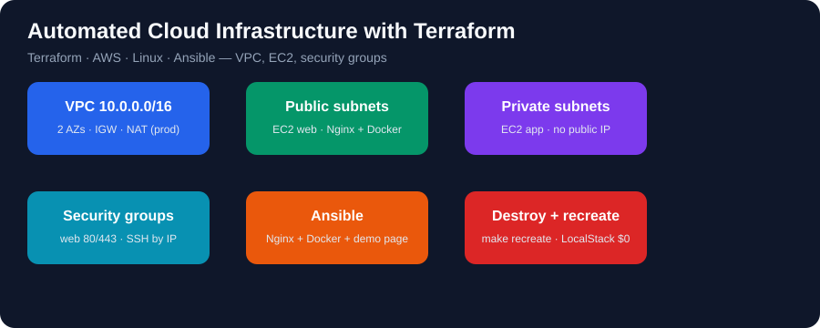
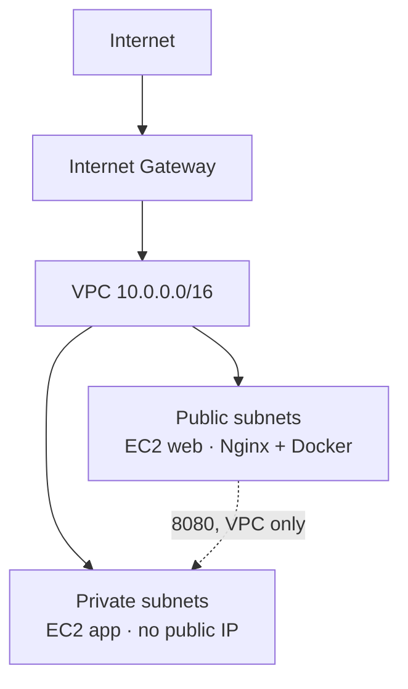

<div align="center">

# ☁️ Automated Cloud Infrastructure with Terraform

**Reusable infrastructure as code — instead of manually configuring servers.**


*Terraform · AWS · Linux (Ubuntu 22.04) · Ansible*

</div>

---

## 🎯 What this does

Provision, configure, destroy, and recreate identical infrastructure from code — **Infrastructure as Code expertise**.

## 🖼️ Architecture





| Piece | What it is |
|---|---|
| **VPC** `10.0.0.0/16` | Across **2 availability zones** |
| **Public subnets** (×2) | Web servers, internet-facing |
| **Private subnets** (×2) | App servers, no public IP |
| **Internet Gateway + route tables**, **NAT Gateway (prod only)** | Outbound internet for private subnets |
| **EC2** | Web servers (public) + app servers (private), `t3.micro`, latest Ubuntu 22.04 AMI looked up automatically |
| **Security groups** | Web (80/443 open), SSH (22, locked to your IP), app (8080, VPC-only) |
| **Ansible** | Installs Nginx + Docker and deploys a demo page; inventory is generated by Terraform from live EC2 IPs |

See [docs/architecture.md](docs/architecture.md) for the diagram and cost breakdown.

📸 **Screenshots:** the architecture diagram above is the visual reference for this repo. A real run screenshot lives in `screenshots/03-destroy-complete.png` (LocalStack destroy, 2026-11-21) — see [Proof](#-proof) below. No fake screenshots are included.

## 🚀 Quickstart

### Prerequisites

- Terraform >= 1.5 — [install](https://developer.hashicorp.com/terraform/install)
- AWS account + credentials (`aws configure` — access key with EC2/VPC permissions)
- Ansible — `pip install ansible` (only needed for the configure step)
- An EC2 key pair (optional, for SSH) — create in AWS Console > EC2 > Key Pairs

No AWS account yet? The code still validates without one (see Verify below).

### Deploy

```bash
# 1. Configure
cp terraform.tfvars.example terraform.tfvars
# Edit terraform.tfvars: set key_name and allowed_ssh_cidr to YOUR IP/32
#   (find your IP: curl https://checkip.amazonaws.com)

# 2. Deploy dev (cheapest: 1× t3.micro, no NAT)
make deploy ENV=dev
# or step by step: make init && make plan && make apply && make configure

# 3. See it live
terraform output web_public_ips
curl http://<ip>/    # "It works — provisioned by Terraform + Ansible"

# 4. Destroy it — and prove you can rebuild it
make destroy ENV=dev
make recreate ENV=dev   # destroy + apply + ansible, one command
```

Prod is the same code, different variables:

```bash
make deploy ENV=prod
```

## 🧭 Commands

| Command | What it does |
|---|---|
| `make init` / `make plan` / `make apply` | Terraform lifecycle for the chosen `ENV` |
| `make configure` | Run the Ansible playbook against the live servers |
| `make deploy` | `apply` + `configure` |
| `make destroy` | Tear everything down |
| `make recreate` | `destroy` + `apply` — the reproducibility demo |
| `make verify` | `curl` each web server's public IP |
| `make fmt` / `make validate` | Format + validate (no AWS needed) |

## 🆓 No AWS account / no card? Run it on LocalStack — $0

See [`localstack/README.md`](localstack/README.md). LocalStack is a fake AWS in Docker on your laptop: same modules, same `apply` / `destroy`, no account, no card, no bill. On this machine it was tested end-to-end against a local mock on port 4566: **16 resources added, 16 destroyed**.

```bash
cd localstack
docker compose up -d
terraform init
terraform apply -auto-approve
terraform destroy -auto-approve
```

Honest limit: mocked EC2 instances have no real OS, so no SSH, no live Nginx page, and the Ansible playbook does not run there. LocalStack proves the Terraform half; Ansible needs real AWS.

## ✅ Verify without AWS

```bash
terraform fmt -check -recursive
terraform init -backend=false
terraform validate   # "Success! The configuration is valid."
```

## 📸 Proof

Run live on a laptop with LocalStack, 2026-11-21 — see [docs/proof.md](docs/proof.md) and [screenshots/03-destroy-complete.png](screenshots/03-destroy-complete.png):

- `terraform apply` — **16 added** (VPC `vpc-c173ce97`, web instance `i-b427fa8793cc4d0a9`)
- `terraform destroy` — **16 destroyed**
- `docker compose down` — LocalStack container and network removed

## 💰 Cost

Dev is free-tier friendly: 1× t3.micro, no NAT — ~$0.64/month for the 8 GB disk after free tier, $0 while destroying after each demo. See `docs/architecture.md`.

## 🔒 Security notes

- Change `allowed_ssh_cidr` from `0.0.0.0/0` to your IP/32 before any real use.
- `terraform.tfvars`, `*.tfstate`, and `*.pem` are git-ignored — never commit them.
- State is local by default; use the commented S3 backend in `versions.tf` for team/prod.

## 📂 Project layout

```
.
├── main.tf  variables.tf  outputs.tf  versions.tf   # root: wires the modules
├── modules/
│   ├── vpc/        # VPC, IGW, subnets, NAT, route tables
│   ├── security/   # web / ssh / app security groups
│   └── compute/    # EC2 web + app (Ubuntu AMI via data source)
├── environments/
│   ├── dev.tfvars    # 1 web, 0 app, no NAT — cheapest
│   └── prod.tfvars   # 2 web, 1 app, NAT on
├── ansible/
│   ├── playbook.yml            # Nginx + Docker + demo page
│   ├── inventory.aws_ec2.yml   # dynamic inventory (alternative)
│   └── inventory.ini.tftpl     # template Terraform fills in
├── scripts/
│   ├── deploy.sh    # terraform apply + ansible
│   ├── destroy.sh   # terraform destroy (asks first)
│   └── recreate.sh  # destroy + apply + ansible
├── localstack/     # $0 LocalStack demo (no AWS account needed)
└── docs/
    ├── architecture.md
    └── destroy-recreate-demo.md
```
